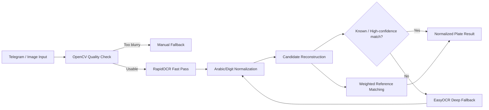

# Saudi Plate OCR & Telegram Automation

A sanitized portfolio refactor of an operational vehicle-reporting project, focused on the **AI/computer-vision layer used to extract Saudi license-plate text from images** and connect the result to a Telegram workflow.

> This public repository intentionally excludes the original operational database, vehicle roster, report templates, personnel data, Telegram sessions, bot tokens, and internal workflow rules.

## My Contribution

My work on the original system included the backend/automation layer around vehicle reporting and, most importantly for this portfolio project, the image-to-plate pipeline:

- Receiving vehicle images through a Telegram workflow.
- Rejecting images that are too blurry before expensive OCR processing.
- Running a fast OCR pass with **RapidOCR / ONNX Runtime**.
- Falling back to **EasyOCR** when the fast pass produced uncertain candidates.
- Normalizing Arabic/Persian/English digits into a single representation.
- Correcting common OCR confusions in Arabic plate letters.
- Reconstructing candidate Saudi plate strings from noisy OCR fragments.
- Matching OCR candidates against an authorized reference dataset.
- Applying weighted fuzzy correction for visually similar digits and Arabic letters.
- Returning a normalized plate result that can be used by the reporting backend.
- Warming OCR models at startup to reduce first-request latency.
- Keeping a manual fallback path when image quality or OCR confidence is insufficient.

## Why This Is More Than Basic OCR

Reading a license plate from a real Telegram photo is not simply `OCR(image)`.

The production workflow had to deal with:

- Motion blur and low-quality phone images
- Arabic and Western digits appearing together
- OCR splitting letters and numbers into separate regions
- Similar-looking Arabic letters
- Similar-looking digits such as `3/8`, `4/5`, `0/6`, and `1/7`
- Partial reads where only part of the number or letter sequence is detected
- Multiple OCR regions that must be recombined
- A known fleet/reference dataset that can be used to resolve ambiguous reads

The resulting design is a **hybrid OCR + domain-correction pipeline**.

## OCR Pipeline



## Key AI / CV Techniques

### 1. Image Quality Gate

OpenCV Laplacian variance is used as a lightweight blur detector. Very blurry images are rejected before OCR, preventing low-quality input from producing misleading plate matches.

### 2. Two-Stage OCR

The pipeline is designed around two OCR stages:

1. **RapidOCR** for low-latency inference.
2. **EasyOCR** as a deeper fallback when the first pass returns uncertain candidates.

This avoids running the slower path on every image.

### 3. Arabic Plate Normalization

OCR output is normalized before matching:

- Arabic and Persian digits → Western digits
- Arabic character variants → canonical forms
- Common OCR substitutions → valid Saudi plate characters
- Whitespace/noise cleanup
- Separation of letters and number groups

### 4. Candidate Reconstruction

OCR engines may detect the plate as multiple text regions. Candidate generation combines:

- Letter windows
- Number groups
- Forward/reversed region combinations
- Multiple OCR source regions

This creates plausible plate candidates even when OCR does not return a clean full plate string.

### 5. Database-Assisted Fuzzy Correction

When an exact match is unavailable, candidates can be scored against an authorized reference list.

The scoring logic gives lower penalties to common visual confusions, for example:

- Digits: `4↔5`, `3↔8`, `6↔8`, `0↔6`, `1↔7`
- Arabic letters: selected visually similar pairs

Digit errors are weighted more heavily than letter errors, and ambiguous near-ties are rejected instead of forcing a match.

## Public Portfolio Code

The public code is a refactor of the OCR orchestration and matching ideas present in the original project.

| File | Purpose |
|---|---|
| `src/plate_ocr_pipeline.py` | Image quality checks, OCR engines, normalization, candidate generation, and reference matching |
| `src/telegram_ocr_example.py` | Safe example showing how the OCR pipeline can be called from Telegram |
| `config/ocr_controls.example.json` | Example OCR correction configuration |
| `config/saudi_plate_letters.csv` | Saudi plate letter mapping |
| `tests/test_normalization.py` | Small tests for normalization and scoring logic |

## Important Source Snapshot Note

In the supplied project snapshot, the operational `linux_bot.py` still contains the OCR orchestration and expects a `SaudiPlateRecognizer` class, but the supplied `plate_ocr.py` file appears to have later been replaced by a PDF-to-Word utility. Therefore this public repository does **not** claim that the missing recognizer implementation was present in that snapshot.

Instead, this portfolio version extracts and documents the OCR architecture and matching logic that is actually visible in the source, and provides a clean standalone refactor suitable for technical review.

## Tech Stack

- Python
- OpenCV
- RapidOCR / ONNX Runtime
- EasyOCR
- NumPy
- Pillow
- python-telegram-bot
- SQLite in the original backend
- ReportLab / PDF tooling in the original reporting layer

## Local Setup

```bash
python -m venv .venv
pip install -r requirements.txt
```

Create a local environment file:

```bash
cp .env.example .env
```

Then run the safe Telegram example only with your own bot token:

```bash
python src/telegram_ocr_example.py
```

## Security & Privacy

The original project contained real operational information. The public portfolio snapshot excludes:

- Telegram bot tokens
- API keys
- bot access secrets
- Telegram persistence/session files
- SQLite databases and backups
- real vehicle plate lists
- personnel/driver names
- internal shift schedules and workflow rules
- PDF/DOCX operational templates
- generated reports
- uploaded OCR images
- cloud-backup identifiers
- font binaries and private assets

See `SECURITY.md`.

## Author

**Hassan Ali Hassan**  
AI Engineer & Backend Developer  
Computer Vision, OCR, Telegram Automation & Data Workflows
